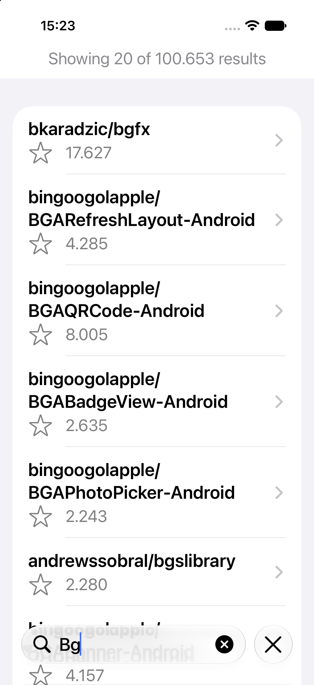
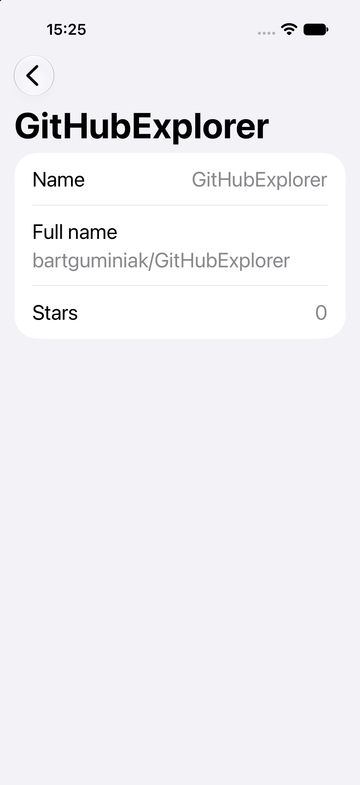

# GitHubExplorer

A lightweight SwiftUI application demonstrating **Swift 6 concurrency**, asynchronous networking, and testable MVVM architecture.

The app lets users search public GitHub repositories and inspect basic repository details. Its technical focus is on actor isolation, cooperative cancellation, handling out-of-order responses, dependency injection, and testing asynchronous operations.

> **Project status:** Technical demonstration project, not a production-ready GitHub client.

## Screenshots

| Repository Search | Repository Details |
|:---:|:---:|
|  |  |

## Features

- Search public GitHub repositories using the GitHub REST API.
- View repository names, star counts, and basic details.
- Debounced search input (350 ms) to reduce unnecessary requests.
- Cooperative task cancellation and protection against outdated responses.
- In-memory repository detail caching isolated by a Swift actor.
- Loading, empty, and error states, with manual retry where appropriate.
- Display of the total GitHub search result count (first 20 results shown).

## Tech Stack

| Area | Technology |
|---|---|
| Language | Swift 6 (app and unit test targets) |
| UI | SwiftUI |
| Architecture | MVVM |
| State management | Observation (`@Observable`) |
| Concurrency | async/await, actors, SwiftUI `.task(id:)` |
| Networking | URLSession, GitHub REST API |
| Dependency injection | Protocol-based |
| Unit testing | Swift Testing |
| UI testing | XCTest / XCUITest |
| Third-party dependencies | None |

## Architecture

The project separates SwiftUI presentation, observable ViewModels, and protocol-based data access.

```text
GitHubExplorer/
├── App/
│   ├── GitHubExplorerApp.swift
│   └── AppDependencies.swift
├── Features/
│   └── Repository/
│       ├── Views/
│       └── ViewModels/
├── Models/
└── Networking/
    ├── HTTPClient.swift
    ├── GitHubAPIClient.swift
    ├── GitHubRepositoryProviding.swift
    └── CachingRepositoryProvider.swift
```

The networking layer uses injectable protocols so ViewModels and API behavior can be tested without live network requests.

## Swift Concurrency

### MainActor and UI State

ViewModels use `@MainActor` isolation to protect observable UI state.

### Task Lifecycle and Cancellation

Search and repository detail screens use SwiftUI's `.task(id:)` to associate asynchronous operations with the view lifecycle. Search is debounced by 350 milliseconds.

Cancellation checks and request identifiers prevent canceled or outdated operations from updating observable state, including when a dependency does not promptly cooperate with cancellation.

### Actor-Based Caching

`CachingRepositoryProvider` is an actor that protects an in-memory repository detail cache. By default, it holds up to 50 entries for the current app session, without time-based expiration. When full, it evicts an arbitrary entry to make room for a new one.

Concurrent misses for the same repository are not deduplicated: each caller performs its own fetch. Cancellation of one caller does not cancel another, and a canceled response is not cached. When concurrent requests succeed, the last successful completion updates the cache.

## Testing

Unit tests use **Swift Testing** and injected test doubles. Coverage includes:

- Repository JSON decoding and HTTP response handling.
- ViewModel loading, success, and failure states.
- Empty search input and search result counts.
- Out-of-order responses and cancellation behavior.
- Error recovery and retry-related state transitions.
- Cache hits, eviction, capacity enforcement, concurrent misses, and cancellation.

Concurrency tests use controlled continuations to simulate selected asynchronous scenarios without relying on arbitrary delays.

An **XCTest UI test** exercises manual recovery from search and repository detail failures using a deterministic, debug-only provider. The UI test fixture is not selected in release builds.

## Getting Started

### Requirements

- Xcode 27.2 or later
- iOS 17.6 or later
- Swift 6 language mode for the app and unit test targets

### Run

1. Clone the repository.
2. Open `GitHubExplorer.xcodeproj` in Xcode.
3. Select an iOS simulator.
4. Build and run.

Basic usage requires no API key or third-party dependencies. Unauthenticated GitHub API requests are subject to rate limits.

### Run Tests

Use **Product → Test** in Xcode (`Cmd + U`) with an appropriate test-enabled scheme.

Unit tests use mocks and do not require live GitHub API access. The UI test uses a debug-only test fixture.

## Known Limitations

- Search fetches only the first page of up to 20 repositories; pagination is not implemented.
- The total search result count is displayed, but GitHub's `incomplete_results` flag is not decoded or exposed.
- Unauthenticated API rate limits may affect requests; detailed rate-limit handling and automatic retries are not implemented.
- Repository details are cached in memory only, with no time-based expiration or persistence across launches.
- Concurrent cache misses are not deduplicated, and eviction is arbitrary rather than LRU.
- Cached repository details may become stale. Search bypasses the detail cache, so star counts may differ; displayed details are not automatically refreshed.

## Project Goals

This project is intended to demonstrate:

- Swift 6 concurrency fundamentals and actor isolation.
- Cancellation-aware asynchronous state management in SwiftUI.
- Dependency injection and testable MVVM architecture.
- Controlled testing of concurrent operations.
- Explicit trade-offs between simplicity and production-level features.

The emphasis is on **clear, reviewable code and practical concurrency patterns**, rather than feature completeness.
